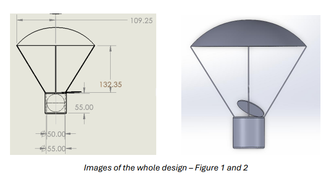
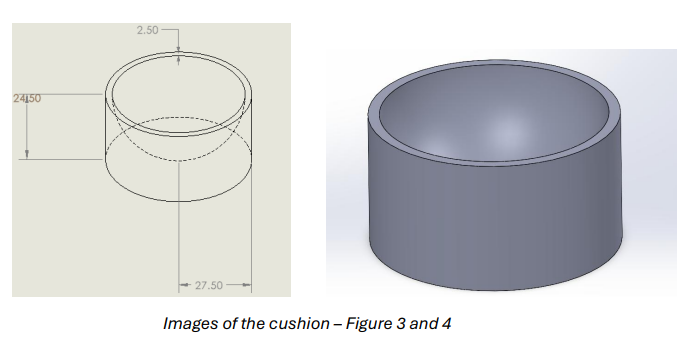

# - Egg Drop Project - 

<h2> Description </h2>

I was tasked to design a reusable vessel intended to protect a raw chicken egg during a drop from height. It was intended to take a payload mass of approximately 55g, the drop path, orientation, and attitude during descent were not defined and open for me to considered as part of the design.

I decided a parachute would be the safest and most reliable mechanism to protect the egg while remaining reusable. It also gave me the chance to learn about parachute design and the physics behind it. 

To start I thought of the rough design, then researched materials that would be suitable for the criterium. Once the materials were decided on; then size, weight and drag calculations were done to create parameters for the CAD. Bellow I go into more detail about the materials used, as well as some mechanics calculations.

<h2> CAD Design </h2>

Being my first experience with any CAD, it took some time and effort to create the design for the capsule, mainly the hollow dome representing the parachute.  

 

  
  

<h2> Resources Used </h2>

- SolidWorks

- Granta EduPack Database 

<h2> Specific Design Parameters </h2>
<h6> Functional Requirements </h6>

FR‑1.   The vessel shall permit the egg to be inserted and removed without damage between successive drops.

FR‑2.   The vessel shall protect the egg such that no fracture or leakage occurs when released from a starting height equivalent to one floor.

FR‑3.   The vessel shall, without modification, protect the egg such that no fracture or leakage occurs when released from a starting height equivalent to four floors.

<h6> Physical and Design  </h6>

DR‑1.   The design shall be reusable and shall not rely on sacrificial destruction of the vessel to meet performance requirements.

DR‑2.   The design shall be fully specified, including:

- Overall geometry and configuration

- Key dimensions

- Estimated total mass

- Identification of all constituent components and materials

DR‑3.   The design shall include a clear representation of the internal egg‑retention and energy‑mitigation strategy.

<h6> Materials and Manufacturing Requirements </h6>

MR‑1. All materials selected shall be drawn from the Approved Materials List provided in the table at the end of the assignment.

MR‑2. Materials selection shall be justified using relevant material properties obtained from Granta EduPack.

MR‑3. For each major component, a plausible manufacturing process shall be identified and justified.

MR‑4. Manufacturing routes shall be appropriate for low to moderate production volumes and non-specialist fabrication environments.

<h6> Sustainability and Life‑Cycle Requirements </h6>

SR‑1.    The design shall incorporate qualitative life‑cycle assessment (LCA) considerations.

SR‑2.    Sustainability justification shall consider, as a minimum:

- Raw material sourcing and embodied energy

- Manufacturing and processing impacts

- Reusability and service life

- End‑of‑life options (reuse, recycling, biodegradation, disposal)

<h2> Executive Summary </h2>

My design is based on a three-component system surrounding the egg; formed from an
absorber to take the impact of the fall, made from natural rubber due to its high poisons
ratio, then encased in a bamboo capsule to keep everything together; the door and its
closing mechanism will also be made from bamboo due to both its strength and low
density. This will then be attached to a parachute, made from Polyethylene, specifically
LDPE, a light non-porous material like that of a plastic bag; this will only make up the
body of the parachute. The attaching ropes will be made from Polypropylene or PP;
manufactured by hot extrusion to form thin strands of the polymer, these strands will
then be woven to form the ropes that will attach the parachute and the capsule. The
main purpose of this design was to slow the decent and limit the terminal velocity using
a parachute so that upon landing the egg should experience minimal force. The rubber
is there to ensure the egg is cushioned and doesn't take the full impact of the fall
mitigating some of the forces that the capsule will experience. I made sure to include a
small gap between the egg and the cushioning to allow compression and expansion of
the rubber without applying force into the egg.
For manufacturing, the rubber and bamboo will be naturally harvested imported and
cut to size to fit the design. The Polyethylene however will use a blow film extrusion to
create plastic bags; the bags will then be cut down to the size and shape suitable for a
parachute. Again, Polypropylene will use a hot extrusion method of manufacturing to
form a rope like material that will be light and strong enough to fit the purpose of a
parachute cord; in order to fit the criteria of small scale production, the fibres will be
purchased and hand woven to form the rope and the plastic bags will be used and
recycled into the parachute.
For the sustainability aspect, most of the thought was put into the natural and
recyclable materials the capsule is made from and their low carbon emissions in terms
of actual manufacture. The same was done when considering the parachute material
and although the polymer used for it is not re-new able or bio-degradable, using already 
made bags to form the parachute cuts the cost of manufacture carbon emission when
forming the eco-audit for the design. The main problem is with the polypropylene for the
parachute rope, not only is it non-renewable and non-biodegradable but it has the
highest carbon footprint in terms of manufacture out of the selected materials.
Unfortunately, it was the only material on the list that would have been suitable to
create a light flexible rope fit for a parachute cord under the conditions of low scale
production. 

<h2> Design Justification </h2>

<h5> Capsule - </h5>
For the capsule, the shape itself is a large part of the force mitigation strategy. Being a
rounded shape, it reduces the corners that otherwise would have been susceptible to
deformation and wear over extended amounts of drops but will also spread the force
out much more evenly, reducing chance of one part failing. The materials of the capsule
were heavily scrutinised to find the optimal material for use. I decided to use rubber for
the cousin, due to its high Poissons ratio of 0.5 the rubber will deform laterally with the
force and therefore apply load across the surface of the egg instead of a compressive
force into it, lowering the overall force experienced by the egg. Also having a low Youngs
Modulus of 0.0012 - 0.0021 GPa demonstrates the materials ability to deform due to
low stiffness, again absorbing the impact more that the egg inside. Its Yield strength
and compressive strength also allow for elastic deformation at the low forces that the
capsule should receive from the fall ensuring that the egg can be dropped multiple
times without permeant deformation, which may negatively affect the forces the egg is
made to take eventually failing to cushion the egg. Finally, natural rubbers fatigue
strength is high, allowing for many drops before any deformation begins to take place.
For the outside shell, I decided to use bamboo. Due to its low density at 602 – 797
Kg/m3
, as well as ideal strength for direct impact; it has a high fracture toughness of
5.69 - 7.01 MPa.m^0.5 and will therefore not crack very easily under large force this
along with its high elongation meaning the material will stretch and not fracture. It also
has a decent tensile strength of 160 – 319 MPa, preferably on the higher side, perfect for
resisting drops as some of the force experienced by the bamboo layer will be tensile.
The only caveat is the high young's modulus as its stiffness is somewhat too high and
therefore the bamboo layer will not absorb much of the force. That’s why I'm only
making the bamboo layer thin, so the rubber takes most of the force, while the bamboo
layer takes the direct impact. The main role of the bamboo was to find a light enough
and solid enough material to hold all the components together while not cracking from
repeated drops. Again, the door and its hinges will all be made from bamboo, as well as
the connecting hoops that will attach the parachute to the capsule. The main concern
with bamboo hinges is obviously its inability to bend frequently, therefore I opted for a
pin style hinge which should allow for small frequent movements, with the only 
problem being the friction caused when opening the door which may make it noisy or
not very smooth.
For the manufacturing aspect of the capsule, thought was put into the actual
manufacturing of the materials and more into the capsule itself, the materials will
easily be sourced from their respective countries, bamboo will most likely come from
China, where as the rubber will likely come from Thailand, where it is extracted from
trees then turned into blocks of natural rubber. The rubber will be easily cut down to fit
the design with a knife; however, the bamboo may be a bit trickier, requiring tools.
Again, the sustainability side of the capsule itself is good due to the natural nature of
the materials, only a slight concern with natural rubber, while the main concern was the
carbon and water cost of transport and harvesting. Bamboo is very sustainable as it
grows fast and doesn't require replanting after being harvested; its carbon footprint and
embodied energy is relatively low at 0.312 - 0.344 CO2/Kg and 20.6 - 22.7 MJ/Kg
respectively. Bamboos water usage is somewhat low and absorbs CO2 as it grows.
Rubber, however, has a larger carbon demand than most natural materials, including
bamboo. At a 2.2–2.43 kg CO₂/kg carbon footprint and a 78–86 MJ/kg embodied energy
it is clear the manufacturing process is less sustainable than bamboo coupled with this
is its considerably higher water consumption at 15.4–20 L/kg making it less eco-friendly
to make. 

<h5> Parachute - </h5>
Consideration was given to the actual design of the parachute even more so
calculations of the size that it needed to be so decent is slow enough to protect the egg.
It just needed to do its job of lowering the terminal velocity of the capsule and so a
basic, semicircular shape was decided upon. I have included a hole at the top of the
parachute to help with stability and made sure the egg will be directly centred to the
parachute. The material was decided purely based on lightness and air porosity making
LDPE a perfect choice out of the options available. Lightweight Polyethylene has a high
tensile strength of 20.7–44.8 MPa although it would be on the smaller side due to its low
thickness, it would still be suitable for a parachute that takes mostly tensile loads at
this scale. At 200 – 800% elongation the material will be able to take the shock of the air
as the parachute opens by stretching slightly, this however must be slightly limited as
too much stretch may lead to problems with the operation, this is where the thickness
of the material will be calculated in order to maximise the properties desired. I also took
the Youngs modulus into account when choosing the material, it needed to be low
enough to allow for some flexibility, however if too low it could again lead to
complications in the aerodynamics. With a Youngs modulus of 0.621–0.896 GPa LDPE
was a suitable choice. Finally, LDPE’s density was crucial to the choice of material as it
couldn't be too heavy but also too thin, therefore a less dense material was optimal
making its density of 939–960 kg/m³ reasonable.
The chords of the parachute will be made with strands of polypropylene, woven into
rope and therefore the material properties will differ from those given on EduPack. Due
to the chords taking all the load of the parachute in a purely tensile way its tensile
strength is crucial, therefore a value of 26–50 MPa is more than enough for the design
even when lowered due to it being woven. PPs Youngs Modulus being 0.824–1.02 GPa is
also suitable as it will allow for stretching to reduce the shock when the parachute
opens, lowering the loads that the bamboo hoops will endure. Again, PPs density is a
standing consideration and at 895–909 kg/m³ it is suitable.
As for the manufacturing route, the parachute itself will be made from used plastic
bags, of which thickness and type will all be hand selected. Plastic bags are
manufactured by hot blown film extrusion, however due to using already made bags it
won't be considered. The bags will be joined through heat sealing to form a large sheet
of LDPE then cut to size. The chords will be made by hot extrusion; heating PP pellets,
then stretching the molten PP into long strands by applying a high pressure to the
material and pushing it through a small hole. These strands will then be cooled down,
solidified and woven into rope fit for the chords.
The sustainability for the parachute section isn't as suitable due to the nonbiodegradable 
and unrenewable nature of the materials. The use of used plastic bags
significantly reduces the carbon footprint of the design as embodied energy isn't
necessary to consider. Polyethylene’s carbon footprint however is still unsatisfactory
with a value of 2.09 - 2.31 CO₂/kg. The main problem is the Polypropylene, with a
carbon footprint of 2.77–3.06 CO₂/kg and embodied energy of 66–73 MJ/kg making it
carbon costly to produce. Also, with a water use of 37–41 L/kg, the use of PP isn't the
best choice in terms of sustainability, however it was necessary for functionality.
The sustainability on the whole was good, the only carbon impact coming from
transport and one manufacturing method. Due to the idea of re-using plastic bags, I
was able to cut down on the heavy impact that the blow film extrusion method would
cause to the audit along with transportation as the bags are already in the UK. Another
supplement to the audit is that both polymers are thermoplastics and can therefore be
re-cycled and will therefore lessen the impact it will have on the environment.
When choosing the materials for the whole design, a material properties criteria was
first established only then did I look at the materials on Edupack to find what would be
suitable. For example, the material the cord would be made from was heavily thought
upon, it was between PP or LDPE however due to a larger tensile strength being needed
PP was chosen; in addition, the tensile strength to density was more ideal for PP
especially when designing a parachute cord. 

<h2> Materials and Properties </h2>
<h4> Polyethylene:</h4>

Youngs Modulus --> 0.621 - 0.896 GPa

Tensile Strength --> 20.7 - 44.8 MPa

Elongation --> 200 – 800%

Density --> 939 – 960 Kg/m3
<h4>Polypropylene:</h4>

Youngs Modulus --> 0.824 - 1.02 GPa

Tensile Strength --> 26–50 MPa

Density --> 895–909 kg/m³
<h4>Bamboo:</h4>

Youngs Modulus --> 0.0012 - 0.0021 GPa

Fracture Toughness --> 5.69 - 7.01 MPa.m^0.5

Density --> 602 – 797 Kg/m3
<h4>Natural Rubber:</h4>

Youngs Modulus --> 0.0012 - 0.0021 GPa

Poissons Ration --> 0.5

Compressive Strength --> 25.2–33.6 MPa

Tensile Strength --> 21 – 28 MPa 

